# Figma plants → dev

## Artist workflow

1. Under **ASSETS** in the shared Figma file, create a frame named `Source/Plants/<Name>`.
2. Put individual, native-size sprite layers in **Stem** and **Flowers** groups or components. Name the layers `stem1`, `stem2`, `flower1`, etc. Copied-image names such as `stem4 1` work too. Existing `Part=Stem, Variant=stem1` components are also supported.
3. Once the plant has at least one stem and one flower, mark the family frame **Ready for dev**.

No `Short` / `Medium` / `Tall` assemblies or manually linked `EXPORTS` instances are needed. Those growth variants are design previews, not the application's data structure.

## Automatic import

The `Import Figma plants` workflow runs hourly and can also be started manually from GitHub Actions. It reads the Figma file, selects only `Source/Plants/*` families whose `devStatus.type` is `READY_FOR_DEV`, validates native dimensions and any existing export links, downloads 1× PNGs directly from the sprite layers, assigns the next unused `plant_N`, and updates:

- `src/assets/pack/plant_N/` with the PNG sprites
- `design/asset-map.json` with source/export node IDs and image hashes
- `src/core/assets.ts` with the visible plant name
- `scripts/map-design-assets.mjs` with the audit name

It then runs typecheck, lint, design tests and the web build before pushing the isolated asset change to `dev`. Vercel deploys the dev branch through its existing Git integration.

## One-time setup

The workflow lives on the default branch so GitHub can schedule it. The job checks out `dev` for the actual import and publication. Add a repository Actions secret named `FIGMA_TOKEN` with the Figma `file_content:read` scope. The token is never stored in the repository or printed in logs.

## Data compatibility

A plant type is a bundled asset family, not a Supabase row. Existing gardens continue to store `plantType` and `imagePath` in their JSON. Do not rename or remove old sprite paths: old clients and saved gardens may still refer to them. No Supabase migration is needed.

## Architecture

```mermaid
flowchart LR
  A["Figma ASSETS<br/>Source/Plants/Name"] --> B["Ready for dev"]
  B --> C["GitHub Actions<br/>hourly Figma API scan"]
  C --> D["Validate sprite dimensions"]
  D --> E["Download native 1× PNGs"]
  E --> F["Update asset map + plant names"]
  F --> G["Tests + web build"]
  G --> H["Push asset-only commit to dev"]
  H --> I["Vercel<br/>dev.cells.garden"]
  I --> J["Web app / GardenStore"]
  J <--> K["Supabase<br/>user garden JSON"]
```

